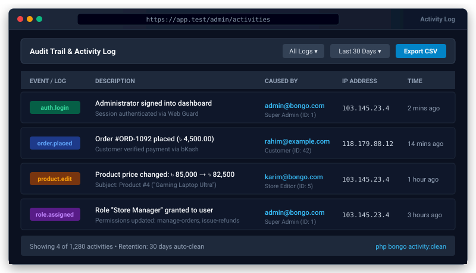

# Bongo Activity Log Package


<p align="center">
  
</p>
An enterprise-ready, zero-dependency audit trail and activity logging package for Bongo MVC. Seamlessly tracks user actions, model lifecycle changes (with old vs new attribute diffs), client IP addresses, User-Agents, and automated pruning.

---

## Features

- **Zero Dependencies:** Pure PHP 8.0+ implementation for Bongo MVC.
- **Fluent Logger:** Chainable `activity()->performedOn($order)->causedBy($user)->log('Payment confirmed')`.
- **Model Trait:** `LogsActivity` trait provides `$model->logActivity()` and automatic event recording with old/new attribute diffs.
- **Request Telemetry:** Automatically captures client IP and User-Agent headers.
- **Auth Integration:** Automatically associates the current logged-in user if `causedBy()` is not explicitly defined.
- **Retention & Pruning:** CLI command `php bongo activity:clean --days=60` to prune old records.
- **Query Scopes:** `Activity::inLog('billing')`, `Activity::forSubject($order)`, `Activity::causedBy($user)`.

---

## Installation

```bash
# Enable in config/packages.php and install
php bongo add activity-log

# Run migrations
php bongo migrate
```

---

## Usage

### Fluent Logging

```php
use Bongo\Packages\ActivityLog\ActivityLog;

// Using the global helper
activity('orders')
    ->performedOn($order)
    ->causedBy($user)
    ->withProperties(['status' => 'paid', 'gateway' => 'bkash'])
    ->log('Order status updated to paid');

// Using the facade
ActivityLog::on($user)->log('Password reset requested');
```

### In Models

```php
namespace App\Models;

use Bongo\Packages\ActivityLog\Traits\LogsActivity;
use System\Database\Model;

class Product extends Model
{
    use LogsActivity;

    protected array $fillable = ['name', 'price', 'stock'];
}

// In your controller:
$product->price = 1500;
$product->recordActivity('updated');
// Automatically records attributes and old diffs, hiding passwords/tokens.
```

### Querying Activities

```php
use Bongo\Packages\ActivityLog\Models\Activity;

// All activities for a specific order
$orderLogs = Activity::forSubject($order)->get();

// All actions taken by a specific user
$userLogs = Activity::causedBy($user)->get();

// Channel-specific logs
$securityLogs = Activity::inLog('security')->get();
```

### Pruning Old Logs

```bash
php bongo activity:clean --days=30
```

---

## License

MIT License. Open source for Bongo MVC projects.
