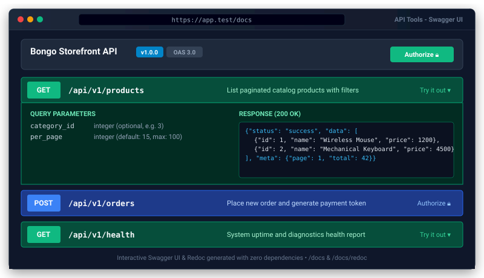

# API Tools Package for Bongo PHP Framework


<p align="center">
  
</p>
Official zero-dependency API development suite for Bongo PHP Framework. Includes Eloquent-style `JsonResource` transformers, paginated `ResourceCollection`, standardized `ApiResponse` formatting, interactive OpenAPI 3.0 (Swagger UI & Redoc) documentation generator, and API rate limiting middleware.

---

## 1. Quick Start

### Step 1: Install Package
```bash
php bongo add api-tools
```

### Step 2: Access Interactive API Documentation
Start your server and navigate to:
- **Swagger UI**: `http://localhost:8000/api/docs`
- **Redoc**: `http://localhost:8000/api/redoc`
- **OpenAPI 3.0 JSON**: `http://localhost:8000/api/openapi.json`

---

## 2. API Resources (Transformers)

### A. Creating a Resource
```bash
php bongo make:resource UserResource
```

Generated Resource in `app/Http/Resources/UserResource.php`:
```php
namespace App\Http\Resources;

use Bongo\Packages\ApiTools\Resources\JsonResource;
use System\Http\Request;

class UserResource extends JsonResource
{
    public function toArray(Request $request): array
    {
        return [
            'id'         => $this->id,
            'name'       => $this->name,
            'email'      => $this->email,
            'is_admin'   => $this->when($this->is_admin, true),
            'profile'    => new ProfileResource($this->whenLoaded('profile')),
            'created_at' => $this->created_at,
        ];
    }
}
```

### B. Conditional Attributes & Relationships
- `when($condition, $value, $default = null)`: Includes the attribute only if the condition evaluates to true.
- `whenLoaded($relationship, $value = null)`: Includes the relation only if it was eager loaded on the model.

### C. Using Resources in Controllers
```php
use App\Http\Resources\UserResource;
use App\Models\User;

// Single Resource
return UserResource::make(User::find(1));

// Resource Collection
return UserResource::collection(User::all());

// Paginated Collection (includes links & meta automatically)
return UserResource::collection(User::paginate(15));
```

---

## 3. Standardized API Responses

Use `ApiResponse` for consistent, predictable JSON structure:

```php
use Bongo\Packages\ApiTools\ApiResponse;

// Success Response (HTTP 200)
return ApiResponse::success($user, 'User profile retrieved successfully');

// Error Response (HTTP 400 or 422)
return ApiResponse::error('Validation failed', 422, [
    'email' => ['The email address is already taken.']
]);

// Paginated Response
return ApiResponse::paginated($paginatedUsers, UserResource::class);

// No Content (HTTP 204)
return ApiResponse::noContent();
```

---

## 4. API Rate Limiting Middleware

Protect your endpoints with sliding window rate limiting:

```php
use Bongo\Packages\ApiTools\Middleware\ApiThrottleMiddleware;
use System\Routing\Route;

Route::middleware('api-throttle:60,1')->group(function () {
    Route::get('/api/users', [UserController::class, 'index']);
});
```

Headers returned on every request:
- `X-RateLimit-Limit`: Maximum requests allowed in the window.
- `X-RateLimit-Remaining`: Number of requests remaining.
- `X-RateLimit-Reset`: Unix timestamp when quota resets.
- `Retry-After`: Returned with HTTP 429 when quota is exceeded.

---

## 5. CLI Commands

- `php bongo api:routes`: Pretty table listing all registered API endpoints, methods, and controllers.
- `php bongo api:docs`: Exports OpenAPI 3.0 specification to JSON (`public/docs/openapi.json`).
- `php bongo make:resource <Name>`: Scaffolds a new `JsonResource` or `ResourceCollection`.

## Security notes

- The interactive docs (`/api/docs`, `/api/redoc`, `/docs/openapi.json`) are **off in production** unless `API_DOCS_ENABLED=true`: the spec lists every route and its middleware.
- `ApiThrottleMiddleware` uses the core's atomic rate limiter, counts per signed-in user (or IP) and per route, and answers `429` with `code: RATE_LIMIT_EXCEEDED`. Use it as `ApiThrottleMiddleware::class . ':60,1'`.
