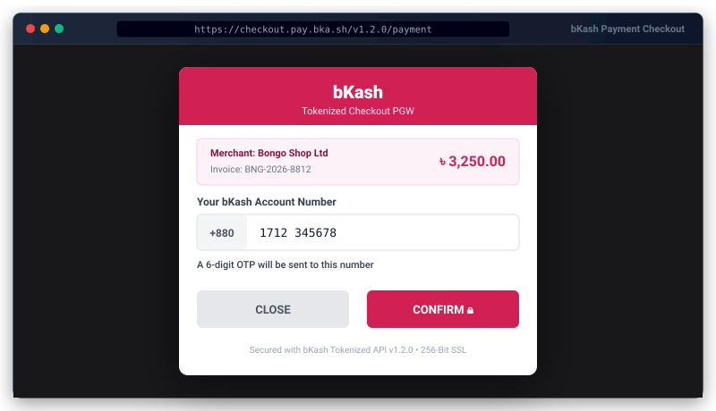

# bKash Payment Gateway for Bongo


<p align="center">
  
</p>
Official zero-dependency bKash Tokenized Checkout (PGW v1.2.0-beta) integration for the Bongo PHP framework.

## 🚀 3-Step Quick Start

### 1. Add Package
```bash
php bongo add bkash
```

### 2. Configure Environment (`.env`)
Add your merchant credentials to your `.env` file:
```env
BKASH_APP_KEY=your_app_key
BKASH_APP_SECRET=your_app_secret
BKASH_USERNAME=your_username
BKASH_PASSWORD=your_password
BKASH_SANDBOX=true
BKASH_CALLBACK_URL=/bkash/callback
```

### 3. Run Migrations
```bash
php bongo migrate
```

---

## 💻 Usage Example

### Initiating a Payment in Controller

```php
use Bongo\Packages\Bkash\BKash;
use System\Http\Request;

class CheckoutController
{
    public function pay(Request $request)
    {
        $gateway = new BKash();

        $payment = $gateway->pay([
            'amount'          => 1250.00,
            'invoice_no'      => 'INV_' . time(),
            'payer_reference' => '01700000000',
        ]);

        // Redirect customer to the secure bKash checkout page
        return redirect($payment['gateway_url']);
    }
}
```

### Handling Payment Verification Manually

If you prefer to handle the callback in your own controller instead of the package's default routes:

```php
public function callback(Request $request)
{
    $gateway = new BKash();
    $result = $gateway->verify($request->all());

    if ($result['valid']) {
        // Payment executed and verified server-side
        $trxId = $result['trx_id'];
        $amount = $result['amount'];
        // Update order status...
        return view('bkash::success', $result);
    }

    return view('bkash::fail', $result);
}
```

---

## 🔔 Events Dispatched

The package automatically fires standard Bongo framework events on verification:

- `payment.success`: Dispatched when transaction verification succeeds (`COMPLETED`).
- `payment.failed`: Dispatched when transaction is cancelled or failed.

Listen to events in `config/bootstrap.php` or your service provider:
```php
use System\Event\Event;

Event::listen('payment.success', function ($transaction) {
    // Send confirmation email, notify customer, update stock
});
```

---

## 🎨 Customizing Views & Translations

Publish assets directly into your application:

```bash
# Publish views to resources/views/vendor/bkash/
php bongo package:publish bkash --views

# Publish translations to resources/lang/vendor/bkash/
php bongo package:publish bkash --lang

# Publish configuration to config/bkash.php
php bongo package:publish bkash --config
```

Application files in `resources/views/vendor/bkash/` and `resources/lang/vendor/bkash/` take priority over package files and survive future package updates.

---

## 🛠️ CLI Diagnostics

Verify your configuration and gateway connectivity:
```bash
php bongo bkash:check
```

Run package test suite:
```bash
php bongo package:test bkash
```
