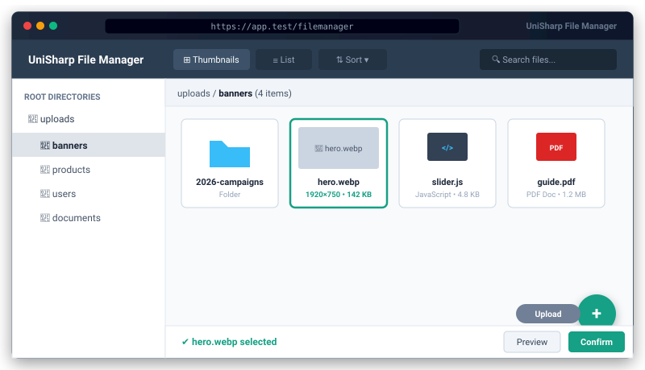

# Bongo File Manager & Code Editor Package


<p align="center">
  
</p>
A zero-dependency, full-featured web file manager and professional in-browser code editor for Bongo MVC, inspired by `unisharp/laravel-filemanager` but built natively with zero server dependencies and first-class code editing support.

---

## Features

- **Zero Server Dependencies:** Pure PHP 8.0+ backend without Node.js or external binary dependencies.
- **Storage Subsystem Integration:** Connects directly with Bongo's `Storage` facade (`Storage::disk('public')`, `'local'`, `'s3'`, `'ftp'`).
- **Professional Code Editor:**
  - In-browser code editing with CodeMirror / Monaco syntax highlighting.
  - Multi-language support: PHP, JavaScript, TypeScript, CSS/SCSS, HTML, JSON, SQL, Markdown, YAML, Shell scripts.
  - Dark mode (`dracula`) & light mode (`eclipse`) themes.
  - Save hotkey: `Ctrl+S` / `Cmd+S` saves asynchronously via REST API without page reloads.
- **File & Media Management:**
  - Create, rename, move, copy, and delete files & directories.
  - Recursive folder navigation & sidebar folder tree.
  - Multi-file drag-and-drop uploads with size & extension checks.
  - Live image previews & thumbnails (JPG, PNG, GIF, WebP, SVG, AVIF).
- **WYSIWYG & Standalone Input Integration:**
  - Standalone button integration via `bongoFileManager()`.
  - TinyMCE 5 / 6 file picker callback.
  - CKEditor 4 / 5 filebrowser integration.
  - Summernote image insertion.
- **Security:** Strict path traversal sanitization, dangerous executable blocking (`.exe`, `.phtml`, `.phar`), and configurable upload size limits.

---

## Installation

```bash
# Enable in config/packages.php and install
php bongo add file-manager
```

---

## Usage

### Direct Browser Access

Open `/filemanager` in your browser to access the complete standalone file manager and code editor interface.

### Standalone Form Field Integration

Add a button to your form to let users pick files from the file manager:

```html
<!-- Input field and preview -->
<input type="text" id="featured_image" name="image">
<button type="button" id="browse_btn">Choose Image</button>


<!-- Include the script helper -->
<script src="/filemanager/script"></script>
<script>
    bongoFileManager({
        button: '#browse_btn',
        targetInput: '#featured_image',
        targetPreview: '#image_preview',
        type: 'image'
    });
</script>
```

### TinyMCE 5 / 6 Integration

```javascript
tinymce.init({
    selector: 'textarea.editor',
    relative_urls: false,
    remove_script_host: false,
    convert_urls: true,
    setup: function (editor) {
        editor.on('init', function () {
            const body = editor.getBody();
            if (body) {
                body.setAttribute('data-gramm', 'false');
                body.setAttribute('data-gramm_editor', 'false');
                body.setAttribute('data-enable-grammarly', 'false');
            }
        });
    },
    file_picker_callback: function (callback, value, meta) {
        var x = window.innerWidth || document.documentElement.clientWidth || document.getElementsByTagName('body')[0].clientWidth;
        var y = window.innerHeight || document.documentElement.clientHeight || document.getElementsByTagName('body')[0].clientHeight;

        var cmsURL = '/filemanager?type=' + (meta.filetype == 'image' ? 'image' : 'file') + '&callback=1';

        window.bongoFileManagerCallback = function (item) {
            callback(item.url, { alt: item.name });
        };

        tinymce.activeEditor.windowManager.openUrl({
            url: cmsURL,
            title: 'Bongo File Manager',
            width: x * 0.8,
            height: y * 0.8,
            resizable: 'yes',
            close_previous: 'no'
        });
    }
});
```

---

## License

MIT License. Open source for Bongo MVC projects.
