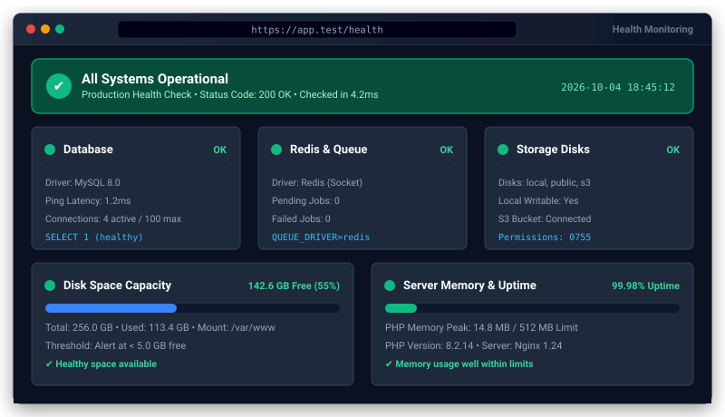

# Bongo Health Check Package


<p align="center">
  
</p>
A production-ready, zero-dependency application health check and uptime monitoring suite for Bongo MVC. Built for DevOps probes, uptime monitors (BetterUptime, Pingdom, UptimeRobot), load balancers, and Kubernetes liveness/readiness probes.

---

## Features

- **Zero Dependencies:** Pure PHP 8.0+ implementation without external packages.
- **Built-in Diagnostic Checks:**
  - **Database:** Connects to active connection, executes `SELECT 1`, and monitors query latency.
  - **Storage:** Verifies write, read, and delete operations on framework storage.
  - **Disk Space:** Monitors free disk space and percentage against configurable thresholds.
  - **Cache:** Tests read/write cache responsiveness.
  - **Redis:** Pings Redis server with `+PONG` if configured as queue driver or cache.
- **Custom Checks:** Easily register application-specific checks (`Health::check('payment_api', fn() => ...)`).
- **HTTP Endpoints:** Standard `/health` and `/api/health` routes returning HTTP 200 (healthy) or HTTP 503 (unhealthy) with JSON telemetry.
- **Privacy & Security:** Support for `HEALTH_SECRET_TOKEN` to mask internal server details from public probes.
- **CLI Diagnostic Tool:** `php bongo health:check` produces a styled terminal status table or JSON output (`--json`).

---

## Installation

```bash
# Enable in config/packages.php and install
php bongo add health
```

---

## Configuration

In `.env`:

```env
# Optional secret token to view detailed diagnostics
HEALTH_SECRET_TOKEN=your-random-token-here

# Minimum free disk space threshold (in megabytes)
HEALTH_DISK_MIN_FREE_MB=500
```

---

## Usage

### Registering Custom Checks

In your `app/Providers` or controller:

```php
use Bongo\Packages\Health\Checks\CheckResult;
use Bongo\Packages\Health\Health;

// Simple boolean callback
Health::check(function () {
    return file_exists('/var/run/custom_daemon.pid');
}, name: 'daemon');

// Detailed CheckResult callback
Health::check(function () {
    $ok = @file_get_contents('https://api.stripe.com/healthcheck');
    return $ok !== false 
        ? CheckResult::ok('stripe_api', 'Stripe API reachable')
        : CheckResult::warning('stripe_api', 'Stripe API unreachable');
}, name: 'stripe_api');
```

### Running Programmatically

```php
use Bongo\Packages\Health\Health;

$report = Health::run();
if ($report['status'] === 'unhealthy') {
    // Notify administrator / pager duty
}
```

### CLI Command

```bash
php bongo health:check
php bongo health:check --json
```

---

## License

MIT License. Open source for Bongo MVC projects.
