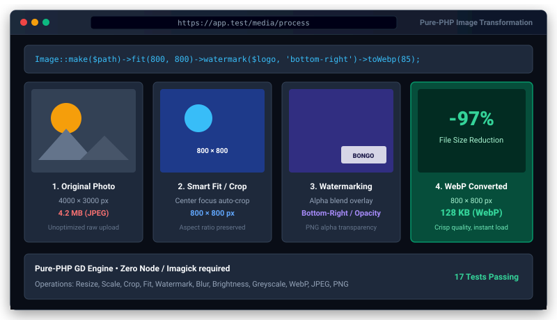

# Image Processing & Optimization for Bongo PHP Framework


<p align="center">
  
</p>
Official zero-dependency image manipulation, resizing, smart cropping, watermarking, and WebP optimization package for Bongo PHP Framework. Powered entirely by PHP's built-in `ext-gd` extension with zero third-party Composer packages.

---

## 1. Quick Start

### Step 1: Install Package
```bash
php bongo add image
```

### Step 2: Configure `.env` (Optional)
```ini
IMAGE_QUALITY=85
IMAGE_WATERMARK_POSITION="bottom-right"
IMAGE_WATERMARK_OPACITY=80
```

### Step 3: Optimize Images via CLI
```bash
# Convert all images in a directory to high-efficiency WebP
php bongo image:optimize public/uploads --webp --quality=85 --max-width=1920

# Optimize a single image in-place
php bongo image:optimize public/assets/banner.png --quality=80
```

---

## 2. Fluent API Usage

### A. Load, Resize & Save as WebP
```php
use Bongo\Packages\Image\Image;

Image::load('storage/app/photo.jpg')
    ->resize(800, 600)
    ->save('public/storage/photo.webp', 85);
```

### B. Smart Crop & Thumbnails
```php
use Bongo\Packages\Image\Image;

// Exact square thumbnail using smart cover & center-crop
Image::load('avatar.png')
    ->thumbnail(200)
    ->save('thumb.webp');

// Fit within bounding box preserving aspect ratio (no stretching)
Image::load('banner.jpg')
    ->fit(1200, 630)
    ->save('og-banner.webp');

// Explicit crop coordinates (x: 10, y: 20, width: 300, height: 300)
Image::load('photo.jpg')
    ->crop(300, 300, 10, 20)
    ->save('cropped.webp');
```

### C. Watermark & Overlays
```php
use Bongo\Packages\Image\Image;

Image::load('storage/app/product.jpg')
    ->watermark('storage/app/watermark.png', position: 'bottom-right', opacity: 75, offsetX: 20, offsetY: 20)
    ->save('public/storage/product-wm.webp');

// Supported positions:
// 'top-left', 'top-center', 'top-right'
// 'center-left', 'center', 'center-right'
// 'bottom-left', 'bottom-center', 'bottom-right'
```

### D. Visual Filters & Adjustments
```php
use Bongo\Packages\Image\Image;

Image::load('photo.jpg')
    ->greyscale()
    ->brightness(10)
    ->contrast(15)
    ->sharpen()
    ->save('enhanced.webp');

// Available filters:
// ->greyscale()
// ->sepia()
// ->invert()
// ->brightness(-255 to 255)
// ->contrast(-100 to 100)
// ->blur(passes: 2)
// ->sharpen()
```

### E. Transformations
```php
use Bongo\Packages\Image\Image;

Image::load('photo.jpg')
    ->rotate(90)          // Clockwise rotation (90, 180, 270)
    ->flipHorizontal()    // Mirror horizontally
    ->flipVertical()      // Flip vertically
    ->save('flipped.webp');
```

### F. Blank Canvas, Drawing & Data URIs
```php
use Bongo\Packages\Image\Image;

// Create blank 400x200 canvas with solid or transparent color
$canvas = Image::create(400, 200, '#1e293b')
    ->text('Bongo PHP', 30, 80, ['color' => '#38bdf8', 'size' => 5]);

// Inline Base64 Data URI for  tags
$dataUri = $canvas->dataUri('webp');
// Output: data:image/webp;base64,...
```

---

## 3. Metadata & Geometry Helpers

```php
$img = Image::load('photo.jpg');

$img->width();        // (int) e.g. 1920
$img->height();       // (int) e.g. 1080
$img->aspectRatio();  // (float) e.g. 1.7777777777778
$img->isLandscape();  // (bool) true
$img->isPortrait();   // (bool) false
$img->isSquare();     // (bool) false
$img->mime();         // (string) e.g. "image/jpeg"
```

---

## 4. Supported Formats

- **WebP** (`.webp`): Google WebP format with full alpha channel and superior compression.
- **JPEG** (`.jpg`, `.jpeg`): Standard lossy photographic compression with configurable quality.
- **PNG** (`.png`): Truecolor with 8-bit alpha transparency.
- **GIF** (`.gif`): Standard graphic interchange format.
- **BMP** (`.bmp`): Windows bitmap format.

---

## 5. Testing

Run package test suite:
```bash
php run_tests.php image
```

## Safety limits

- Images larger than `IMAGE_MAX_PIXELS` (default 50,000,000 pixels) are refused **before** decoding, so a tiny file that claims huge dimensions (a decompression bomb) cannot exhaust memory.
- `Image::read('https://...')` fetches only `http(s)` URLs on public addresses (never `127.0.0.1`, `10.x`, `169.254.169.254`...), without following redirects, up to `IMAGE_MAX_DOWNLOAD_BYTES` (default 10 MB). Strings with any other scheme (`ftp://`, `phar://`...) are refused and never touched as files.
