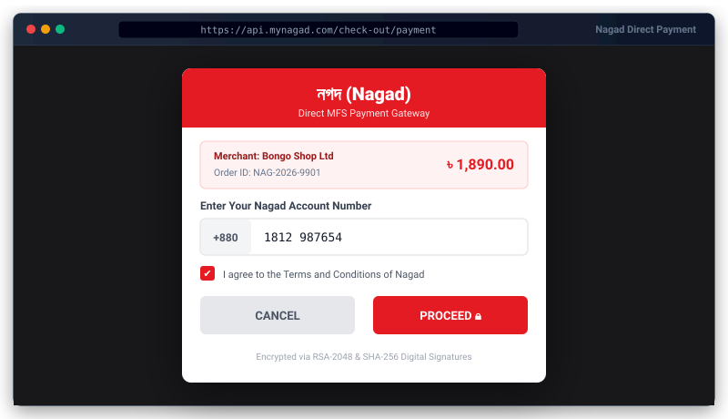

# Nagad Payment Gateway for Bongo


<p align="center">
  
</p>
Official zero-dependency Nagad Payment Gateway (PGW v-0.2) integration for the Bongo PHP framework.

## 🚀 3-Step Quick Start

### 1. Add Package
```bash
php bongo add nagad
```

### 2. Configure Environment (`.env`)
Generate or specify your RSA keys and merchant credentials in `.env`:
```env
NAGAD_MERCHANT_ID=your_merchant_id
NAGAD_MERCHANT_PRIVATE_KEY=storage/nagad/merchant_private.pem
NAGAD_PUBLIC_KEY=storage/nagad/nagad_public.pem
NAGAD_SANDBOX=true
NAGAD_CALLBACK_URL=/nagad/callback
```

> **Tip:** Run `php bongo nagad:keys --save` to generate a 2048-bit RSA keypair in `storage/nagad/`.

### 3. Run Migrations
```bash
php bongo migrate
```

---

## 💻 Usage Example

### Initiating a Payment in Controller

```php
use Bongo\Packages\Nagad\Nagad;
use System\Http\Request;

class CheckoutController
{
    public function pay(Request $request)
    {
        $gateway = new Nagad();

        $payment = $gateway->createPayment([
            'order_id' => 'ORD_' . time(),
            'amount'   => 1500.00,
        ]);

        // Redirect customer to the secure Nagad payment portal
        header('Location: ' . $payment['callBackUrl']);
        exit;
    }
}
```

### Handling Payment Verification Manually

If you want to handle the callback in your own controller instead of the package's default route (`/nagad/callback`):

```php
public function callback(Request $request)
{
    $gateway = new Nagad();
    $result = $gateway->verify($request->all());

    if ($result['valid']) {
        // Payment verified server-side via Nagad API
        $trxId = $result['issuer_trx_id'];
        $orderId = $result['order_id'];
        $amount = $result['amount'];

        // Fulfill order...
        return view('nagad::success', $result);
    }

    return view('nagad::fail', $result);
}
```

---

## 🔔 Events Dispatched

The package automatically fires standard Bongo framework events on verification:

- `payment.success`: Dispatched when transaction verification succeeds (`SUCCESS`).
- `payment.failed`: Dispatched when transaction fails or is declined.
- `payment.cancelled`: Dispatched when the customer cancels checkout on the Nagad portal.

Listen to events in `config/bootstrap.php` or your service provider:
```php
use System\Events\Event;

Event::listen('payment.success', function ($payment) {
    if (($payment['gateway'] ?? '') === 'nagad') {
        // Update order status, decrement inventory, send receipt email
    }
});
```

---

## 🎨 View Components & Customization

Include the checkout button directly in any template:
```html
<x-nagad::checkout-button :amount="$order->total" :order-id="$order->id" />
```
Or as a partial:
```html
@include('nagad::checkout-button', ['amount' => 1500, 'orderId' => 'ORD_101'])
```

Publish assets into your application to customize views and translations:
```bash
php bongo package:publish nagad --views   # copies to resources/views/vendor/nagad/
php bongo package:publish nagad --lang    # copies to resources/lang/vendor/nagad/
```

---

## 🛠️ CLI Commands

```bash
php bongo nagad:check         # Verify credentials, RSA keys, and API connectivity
php bongo nagad:keys [--save] # Generate a new 2048-bit RSA keypair
```
