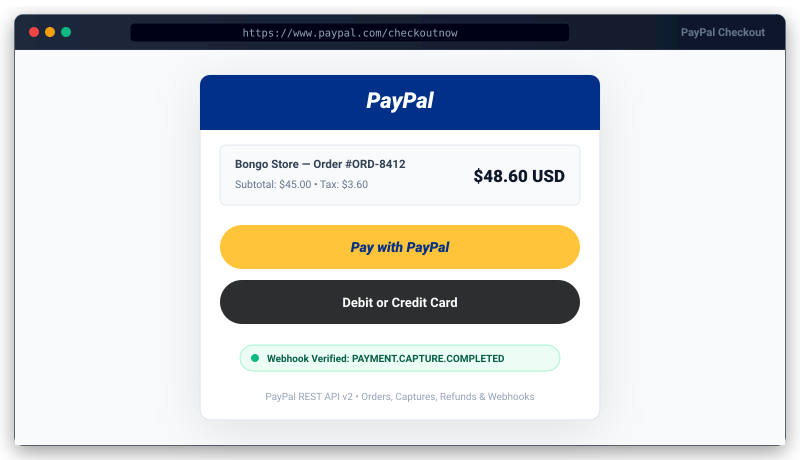

# PayPal Package for Bongo PHP Framework


<p align="center">
  
</p>
Official zero-dependency PayPal payment gateway package for Bongo PHP Framework. Supports PayPal REST API v2 Checkout, order creation, payment capture, authorization, refunds, and cryptographically verified webhooks via pure PHP without external Composer libraries.

---

## 1. Quick Start

### Step 1: Install Package
```bash
php bongo add paypal
```

### Step 2: Run Database Migration
```bash
php bongo migrate
```

### Step 3: Configure `.env`
```ini
PAYPAL_MODE=sandbox
PAYPAL_CLIENT_ID=your_client_id
PAYPAL_CLIENT_SECRET=your_client_secret
PAYPAL_WEBHOOK_ID=your_webhook_id
PAYPAL_CURRENCY=USD
PAYPAL_RETURN_URL=/paypal/success
PAYPAL_CANCEL_URL=/paypal/cancel
```

### Step 4: Verify Connectivity
```bash
php bongo paypal:check
```

---

## 2. API Usage

### A. Create PayPal Order & Redirect
```php
use Bongo\Packages\Paypal\Paypal;

$order = Paypal::create([
    'amount'       => 29.99,
    'currency'     => 'USD',
    'description'  => 'Premium Membership',
    'reference_id' => 'ORDER-1002',
    'custom_id'    => 'USER-42',
]);

$approvalUrl = Paypal::approvalUrl($order);

// Redirect buyer to PayPal checkout approval page
header('Location: ' . $approvalUrl);
exit;
```

### B. Capture Approved Order
```php
use Bongo\Packages\Paypal\Paypal;

// Order ID returned as 'token' query param by PayPal on redirect
$capture = Paypal::capture($orderId);

if (($capture['status'] ?? '') === 'COMPLETED') {
    $captureId = $capture['purchase_units'][0]['payments']['captures'][0]['id'];
    // Order successfully paid and captured
}
```

### C. Issue Refund
```php
use Bongo\Packages\Paypal\Paypal;

// Full refund
$refund = Paypal::issueRefund($captureId);

// Partial refund
$refund = Paypal::issueRefund($captureId, 15.00, 'USD', 'Customer request');
```

### D. Testing / Offline Mocking
```php
use Bongo\Packages\Paypal\Paypal;

Paypal::fake();

$order = Paypal::create([
    'amount'   => 50.00,
    'currency' => 'USD',
]);

$approvalUrl = Paypal::approvalUrl($order);
$capture = Paypal::capture('ORDER-MOCK-12345');
```

---

## 3. Webhook Handling

Register your webhook in PayPal Developer Dashboard pointing to:
`https://yourdomain.com/paypal/webhook`

Events automatically dispatched to Bongo's Event bus:
- `payment.success`: Fires on `PAYMENT.CAPTURE.COMPLETED`.
- `payment.failed`: Fires on `PAYMENT.CAPTURE.DENIED`.
- `payment.refunded`: Fires on `PAYMENT.CAPTURE.REFUNDED`.
- `paypal.order.approved`: Fires on `CHECKOUT.ORDER.APPROVED`.

## Payment events: once per payment

`payment.success` fires **once** per order: the return page's `capture()` and PayPal's `PAYMENT.CAPTURE.COMPLETED` webhook do not both report it, refreshing the return page does not report it again, and webhook retries (same event id) are handled once. A completed order is never marked denied. Order and capture ids are validated before they are placed in PayPal API paths.

`POST /paypal/checkout` takes `amount` and `reference_id` from the browser, so it is **off** unless `PAYPAL_DEMO_CHECKOUT=true` (testing only). In your app call `Paypal::create([...])` from your own controller with the amount of the order loaded on the server.
