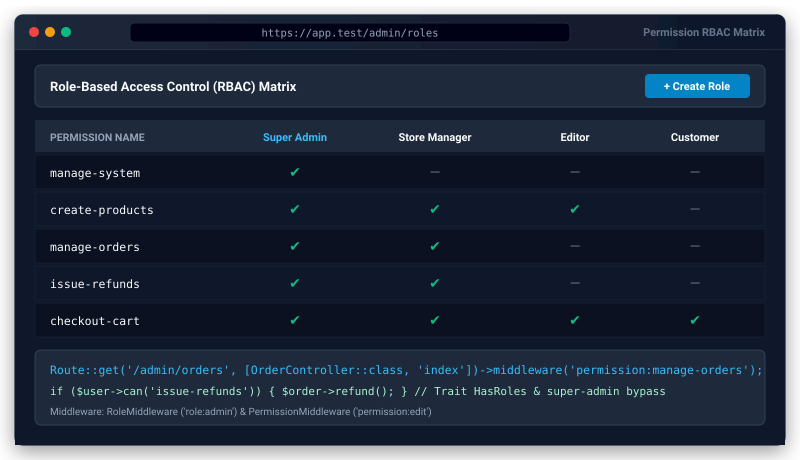

# Role-Based Access Control (RBAC) & Permissions for Bongo PHP Framework


<p align="center">
  
</p>
Official zero-dependency Role-Based Access Control (RBAC) and permissions package for Bongo PHP Framework. Assign roles and permissions to users, guard routes via middleware, check permissions in templates (@-directives), and administer roles through the CLI.

---

## 1. Quick Start

### Step 1: Install Package
```bash
php bongo add permission
```

### Step 2: Run Database Migrations
```bash
php bongo migrate
```

### Step 3: Add `HasRoles` Trait to User Model
In `app/Models/User.php`:

```php
namespace App\Models;

use Bongo\Packages\Permission\Traits\HasRoles;
use System\Database\Model;

class User extends Model
{
    use HasRoles;
    // ...
}
```

---

## 2. API Usage

### A. Assigning & Checking Roles
```php
use App\Models\User;
use Bongo\Packages\Permission\Models\Role;

$user = User::find(1);

// Assign roles by name or model
$user->assignRole('admin');
$user->assignRole(['manager', 'editor']);

// Checking roles
$user->hasRole('admin');                 // true
$user->hasAnyRole(['admin', 'editor']);  // true
$user->hasAllRoles(['admin', 'billing']); // false

// Removing & Syncing
$user->removeRole('editor');
$user->syncRoles(['staff']);             // removes all roles and sets 'staff'
```

### B. Direct & Inherited Permissions
```php
use Bongo\Packages\Permission\Models\Role;
use Bongo\Packages\Permission\Models\PermissionModel;

// 1. Give direct permission to user
$user->givePermissionTo('edit-articles');
$user->can('edit-articles'); // true

// 2. Give permission via role
$role = Role::findOrCreate('moderator');
$role->givePermissionTo(['delete-comments', 'ban-users']);

$user->assignRole('moderator');
$user->can('delete-comments'); // true (inherited via moderator role)

// 3. Super Admin bypass
// Any user with role 'super-admin' passes all can() checks automatically!
$user->assignRole('super-admin');
$user->can('any-action'); // true
```

---

## 3. Protecting Routes with Middleware

In `routes.php`:

```php
use Bongo\Packages\Permission\Middleware\RoleMiddleware;
use Bongo\Packages\Permission\Middleware\PermissionMiddleware;

// Guard by role (single or pipe-delimited alternatives)
Route::get('/admin/dashboard', [AdminController::class, 'index'])
    ->middleware([RoleMiddleware::class . ':admin|manager']);

// Guard by permission
Route::post('/articles', [ArticleController::class, 'store'])
    ->middleware([PermissionMiddleware::class . ':create-articles']);
```

---

## 4. CLI Commands

```bash
# Create roles
php bongo role:create manager
php bongo role:create admin

# Create permissions
php bongo permission:create edit-articles
php bongo permission:create delete-articles

# Assign role to user
php bongo role:assign 1 admin
```

---

## 5. Testing

Run package test suite:
```bash
php run_tests.php permission
```
