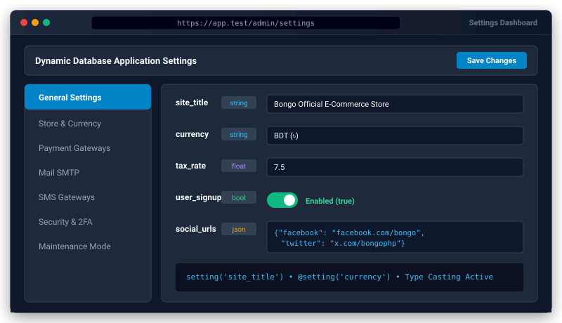

# Bongo Settings Package


<p align="center">
  
</p>
A zero-dependency, type-safe application and store settings manager for Bongo MVC. Stores dynamic configuration in the database with in-memory & persistent caching, type casting (boolean, integer, float, json, string), console CLI commands, and a Blade template directive.

---

## Features

- **Zero Third-Party Dependencies:** Pure PHP 8.0+ implementation using Bongo's native database layer.
- **Type-Casting:** Automatic casting to `boolean`, `integer`, `float`, `json`/`array`, and `string`.
- **In-Memory & Cache Performance:** Loaded settings are cached in memory for zero database queries on repeated calls.
- **Global Helper:** Ergonomic `setting('site.name', 'Default')` and `setting(['site.phone' => '...'])`.
- **Static Facade:** `Setting::get()`, `Setting::set()`, `Setting::has()`, `Setting::forget()`, `Setting::all()`.
- **CLI Commands:**
  - `php bongo setting:get <key>`
  - `php bongo setting:set <key> <value> [--type=] [--group=]`
  - `php bongo setting:list [--group=]`
  - `php bongo setting:clear`
- **Blade Directive:** `@setting('site.name')` automatically escaped for safe HTML rendering.

---

## Installation

```bash
# Enable in config/packages.php and install
php bongo add settings

# Run database migrations
php bongo migrate
```

---

## Usage

### Getting Settings

```php
use Bongo\Packages\Settings\Setting;

// Using the global helper
$siteName = setting('site.name', 'My Application');
$taxRate = setting('shop.tax_rate', 0.05);
$maintenance = setting('app.maintenance', false);

// Using the static Facade
$logo = Setting::get('site.logo', '/images/logo.png');
```

### Setting Values

```php
// Single setting (type is auto-detected)
setting()->set('site.name', 'Acme Store');
setting()->set('shop.enabled', true);
setting()->set('contact.emails', ['support@example.com', 'sales@example.com']);

// Batch setting
setting([
    'currency' => 'BDT',
    'min_order_amount' => 500,
    'enable_cod' => true,
]);

// Explicit type and category/group
Setting::set('api.timeout', 30, type: 'integer', group: 'api');
```

### Checking and Deleting

```php
if (Setting::has('payment.stripe.secret')) {
    // ...
}

Setting::forget('temporary_flag');
```

### In Templates

```html
<header>
    <h1>@setting('site.name')</h1>
</header>
```

---

## License

MIT License. Open source for Bongo MVC projects.
