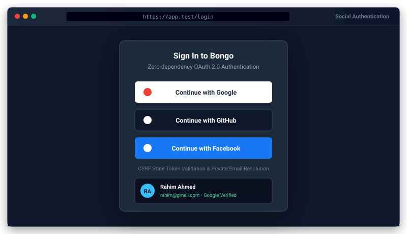

# Bongo Social Login (OAuth 2.0) Package


<p align="center">
  
</p>
Seamless Google, GitHub, and Facebook OAuth 2.0 social login for the Bongo Framework.

Zero external dependencies, pure PHP implementation utilizing Bongo's built-in HTTP client and Auth subsystems.

---

## 1. Quick Start

### Step 1: Install Package
```bash
php bongo add social-login
```

### Step 2: Configure `.env`
Add your OAuth application client IDs and client secrets:
```env
# Google OAuth
GOOGLE_CLIENT_ID=your_google_client_id.apps.googleusercontent.com
GOOGLE_CLIENT_SECRET=your_google_client_secret
GOOGLE_REDIRECT_URI=http://127.0.0.1:8000/auth/google/callback

# GitHub OAuth
GITHUB_CLIENT_ID=your_github_client_id
GITHUB_CLIENT_SECRET=your_github_client_secret
GITHUB_REDIRECT_URI=http://127.0.0.1:8000/auth/github/callback

# Facebook OAuth
FACEBOOK_CLIENT_ID=your_facebook_app_id
FACEBOOK_CLIENT_SECRET=your_facebook_app_secret
FACEBOOK_REDIRECT_URI=http://127.0.0.1:8000/auth/facebook/callback
```

### Step 3: Run Database Migration
Add `provider`, `provider_id`, and `avatar` columns to your `users` table:
```bash
php bongo migrate
```

### Step 4: Verify Configuration
```bash
php bongo social:check
```

---

## 2. Rendering Login Buttons

Embed responsive, styled login buttons with SVG logos anywhere in your Blade/PHP templates:
```html
@include('social-login::buttons')
```

---

## 3. Events

When a user successfully signs in through any provider, the `social.login` event is dispatched:
```php
use System\Events\Event;

Event::listen('social.login', function (array $payload) {
    $provider = $payload['provider']; // 'google', 'github', or 'facebook'
    $user     = $payload['user'];     // Bongo\Packages\SocialLogin\SocialUser

    // Custom business logic, audit logs, or notifications
});
```

---

## 4. Customizing Views & Translations

To customize button design or translations, publish assets into your application:
```bash
php bongo package:publish social-login --views --lang
```
- Views: `resources/views/vendor/social-login/buttons.php`
- Translations: `resources/lang/vendor/social-login/en.json` and `bn.json`

## Account linking and security

- A social sign-in is linked to an existing account with the same email **only when the provider verified that email** (Google `email_verified`; GitHub and Facebook only return verified emails). Otherwise a new account is created with a placeholder email, so nobody can sign in as someone else by adding their address to a social account. Turn linking off with `'link_by_verified_email' => false`.
- The routes use the `web` middleware: the OAuth `state` is kept in the session and checked on the callback.
- An unknown provider in the URL is a 404. Provider errors are logged; visitors see a generic message.
- Custom providers (`SocialLogin::extend()`): set `raw['email_verified'] = true` only when your provider confirms the email.
