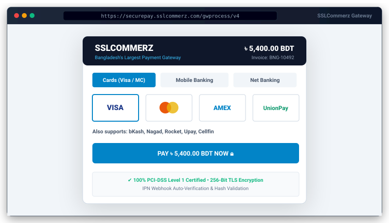

# SSLCommerz Payment Gateway for Bongo


<p align="center">
  
</p>
Official zero-dependency SSLCommerz payment gateway integration for the Bongo PHP framework.

## 🚀 3-Step Quick Start

### 1. Add Package
```bash
php bongo add sslcommerz
```

### 2. Configure Environment (`.env`)
Add your merchant credentials to your `.env` file:
```env
SSLCOMMERZ_STORE_ID=your_store_id
SSLCOMMERZ_STORE_PASSWORD=your_store_password
SSLCOMMERZ_SANDBOX=true
SSLCOMMERZ_CURRENCY=BDT
SSLCOMMERZ_SUCCESS_URL=/sslcommerz/success
SSLCOMMERZ_FAIL_URL=/sslcommerz/fail
SSLCOMMERZ_CANCEL_URL=/sslcommerz/cancel
SSLCOMMERZ_IPN_URL=/sslcommerz/ipn
```

### 3. Run Migrations
```bash
php bongo migrate
```

---

## 💻 Usage Example

### Initiating a Payment in Controller

```php
use Bongo\Packages\Sslcommerz\SSLCommerz;
use System\Http\Request;

class CheckoutController
{
    public function pay(Request $request)
    {
        $gateway = new SSLCommerz();

        $payment = $gateway->initiate([
            'amount' => 1250.00,
            'tran_id' => 'TXN_' . time(),
            'customer_name' => 'Rahim Ahmed',
            'customer_email' => 'rahim@example.com',
            'customer_phone' => '01700000000',
            'customer_address' => 'Gulshan-2, Dhaka',
            'product_name' => 'Order #10042',
        ]);

        // Redirect customer to the secure gateway page
        return redirect($payment['gateway_url']);
    }
}
```

### Handling Payment Verification Manually

If you prefer to handle the success callback in your own controller instead of the package's default routes:

```php
public function callback(Request $request)
{
    $gateway = new SSLCommerz();
    $result = $gateway->verify($request->all());

    if ($result['valid']) {
        // Payment verified server-side
        $tranId = $result['tran_id'];
        $amount = $result['amount'];
        // Update order status...
        return view('sslcommerz::success', $result);
    }

    return view('sslcommerz::fail', $result);
}
```

---

## 🔔 Events Dispatched

The package automatically fires standard Bongo framework events on verification:

- `payment.success`: Dispatched when transaction verification succeeds (`VALID` or `VALIDATED`).
- `payment.failed`: Dispatched when transaction is invalid or failed.

Listen to events in `app/bootstrap.php`:
```php
use System\Event\Event;

Event::listen('payment.success', function ($transaction) {
    // Send confirmation email, notify customer, update stock
});
```

---

## 🎨 Customizing Views & Translations

Publish assets directly into your application:

```bash
# Publish views to resources/views/vendor/sslcommerz/
php bongo package:publish sslcommerz --views

# Publish translations to resources/lang/vendor/sslcommerz/
php bongo package:publish sslcommerz --lang

# Publish configuration to config/sslcommerz.php
php bongo package:publish sslcommerz --config
```

Application files in `resources/views/vendor/sslcommerz/` and `resources/lang/vendor/sslcommerz/` take priority over package files and survive future package updates.

---

## 🛠️ CLI Diagnostics

Verify your configuration and gateway connectivity:
```bash
php bongo sslcommerz:check
```

Run package test suite:
```bash
php bongo package:test sslcommerz
```
