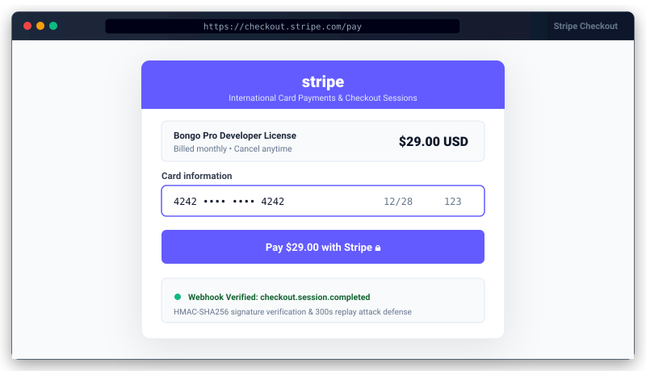

# Stripe Package for Bongo PHP Framework


<p align="center">
  
</p>
Official zero-dependency Stripe payment gateway package for Bongo PHP Framework. Enables global credit/debit card processing, Apple Pay, Google Pay, Stripe Checkout, Payment Intents, refunds, and cryptographically verified webhooks via pure PHP without external Composer libraries.

---

## 1. Quick Start

### Step 1: Install Package
```bash
php bongo add stripe
```

### Step 2: Run Database Migration
```bash
php bongo migrate
```

### Step 3: Configure `.env`
```ini
STRIPE_KEY=pk_test_...
STRIPE_SECRET=sk_test_...
STRIPE_WEBHOOK_SECRET=whsec_...
STRIPE_CURRENCY=usd
```

### Step 4: Verify Connectivity
```bash
php bongo stripe:check
```

---

## 2. API Usage

### A. Stripe Checkout Session (Hosted Redirect)
```php
use Bongo\Packages\Stripe\Stripe;

$session = Stripe::checkout([
    'amount'         => 49.99,
    'currency'       => 'usd',
    'name'           => 'Annual Pro Subscription',
    'customer_email' => 'customer@example.com',
    'client_reference_id' => 'ORDER-1001',
    'metadata'       => [
        'user_id'  => 42,
        'order_id' => 1001,
    ],
]);

// Redirect customer to Stripe hosted checkout
header('Location: ' . $session['url']);
exit;
```

### B. Payment Intents (Custom UI / Elements)
```php
use Bongo\Packages\Stripe\Stripe;

$intent = Stripe::paymentIntent([
    'amount'        => 25.00,
    'currency'      => 'usd',
    'receipt_email' => 'customer@example.com',
    'metadata'      => ['order_id' => 1002],
]);

// Return client_secret to frontend Stripe Elements
return json([
    'clientSecret' => $intent['client_secret'],
]);
```

### C. Issue Refunds
```php
use Bongo\Packages\Stripe\Stripe;

// Full refund
$refund = Stripe::issueRefund('pi_3MtwBwLkdIwHu7ix28a3tqPa');

// Partial refund
$partialRefund = Stripe::issueRefund('pi_3MtwBwLkdIwHu7ix28a3tqPa', 15.00, 'requested_by_customer');
```

### D. Webhook Verification
```php
use Bongo\Packages\Stripe\Stripe;

$payload = file_get_contents('php://input');
$sigHeader = $_SERVER['HTTP_STRIPE_SIGNATURE'] ?? '';

try {
    $event = Stripe::verify($payload, $sigHeader);
    
    if ($event['type'] === 'checkout.session.completed') {
        $session = $event['data']['object'];
        // Fulfill order
    }
} catch (\Throwable $e) {
    http_response_code(400);
    exit('Webhook verification error: ' . $e->getMessage());
}
```

---

## 3. Events Dispatched

The package automatically dispatches Bongo framework events:

| Event | Payload |
|---|---|
| `stripe.webhook` | Raw parsed Stripe webhook event array |
| `payment.success` | `['gateway' => 'stripe', 'session_id' => ..., 'amount' => ..., 'currency' => ...]` |
| `payment.failed` | `['gateway' => 'stripe', 'payment_intent_id' => ..., 'error' => ...]` |

Listen in `app/bootstrap.php`:
```php
use System\Events\Event;

Event::listen('payment.success', function ($data) {
    if ($data['gateway'] === 'stripe') {
        // Update database order status, send email, etc.
    }
});
```

---

## 4. UI Components & Views

### Checkout Button Component
Embed anywhere in templates:
```html
<x-stripe::checkout-button :amount="49.99" :currency="'usd'" :name="'Annual Subscription'" />
```
Or via directive:
```php
@include('stripe::checkout', ['amount' => 49.99, 'name' => 'Annual Subscription'])
```

### Built-in Views
- `stripe::success` — Modern confirmation card with transaction ID and return button.
- `stripe::cancel` — Clean cancellation card.
- Customization: run `php bongo package:publish stripe --views` to copy templates to `resources/views/vendor/stripe/`.

---

## 5. Security & Zero Dependencies

- **Pure PHP 8.0+**: Zero external Composer packages. Uses native `curl` and `hash_hmac`.
- **HMAC-SHA256 Webhook Verification**: Constant-time signature verification (`hash_equals`) and replay attack prevention with timestamp tolerance checks.
- **Amounts Handled Safely**: Automatically converts standard float amounts to Stripe zero-decimal units or integer cents.

## Payment events: once per payment

`payment.success` fires **exactly once** per payment, with `order_id` from your metadata:

- Stripe retries webhooks; every event id is handled once.
- A Checkout payment is reported by `checkout.session.completed` only when `payment_status` is `paid`. Delayed methods (bank debits) are reported later by `checkout.session.async_payment_succeeded`; `checkout.session.async_payment_failed` fires `payment.failed`.
- `payment_intent.succeeded` reports PaymentIntents made with `createPaymentIntent()` (Checkout's own PaymentIntent is not reported twice).
- A paid payment is never marked failed. Events for payments need the `stripe_payments` table (run the migrations).

`POST /stripe/checkout` takes `amount` and `order_id` from the browser, so it is **off** unless `STRIPE_DEMO_CHECKOUT=true` (testing only). In your app call `Stripe::checkout([...])` from your own controller with the amount of the order loaded on the server.
