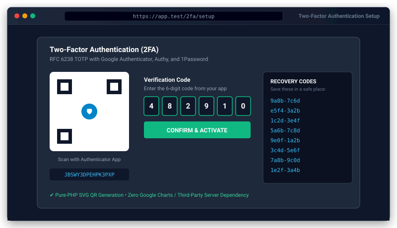

# Two-Factor Authentication (2FA) for Bongo PHP Framework


<p align="center">
  
</p>
Official zero-dependency RFC 6238 TOTP Two-Factor Authentication package for Bongo PHP Framework. Works with Google Authenticator, Authy, 1Password, and Microsoft Authenticator with a native pure-PHP SVG QR code generator, single-use recovery codes, and verification middleware.

---

## 1. Quick Start

### Step 1: Install Package
```bash
php bongo add two-factor
```

### Step 2: Run Database Migration
```bash
php bongo migrate
```

### Step 3: Configure `.env` (Optional)
```ini
TWO_FACTOR_ISSUER="My Bongo App"
```

### Step 4: Test in CLI
```bash
php bongo 2fa:generate admin@example.com
```

---

## 2. API Usage

### A. Secret & TOTP Code Generation
```php
use Bongo\Packages\TwoFactor\TwoFactor;

// Generate 16-character Base32 secret
$secret = TwoFactor::generateSecret(16); // e.g. JBSWY3DPEHPK3PXP

// Generate current 6-digit TOTP code
$code = TwoFactor::generateTotp($secret); // e.g. 123456

// Verify user submitted code (with +/- 1 step drift tolerance)
if (TwoFactor::verify($secret, $submittedCode)) {
    // Code is valid!
}
```

### B. Pure-PHP SVG QR Code
```php
use Bongo\Packages\TwoFactor\TwoFactor;

// Inline SVG markup
$svg = TwoFactor::qrCodeSvg('user@example.com', $secret, 'My App');

// Base64 Data URI for  tag
$dataUri = TwoFactor::qrCodeDataUri('user@example.com', $secret, 'My App');
```

### C. Single-Use Recovery Codes
```php
use Bongo\Packages\TwoFactor\TwoFactor;

// Generate 8 codes (e.g. ['A1B2-C3D4', ...])
$codes = TwoFactor::generateRecoveryCodes(8);

// Hash for database storage
$hashed = array_map([TwoFactor::class, 'hashRecoveryCode'], $codes);

// Verify and consume one code
if (TwoFactor::verifyRecoveryCode($userInputCode, $hashed)) {
    // Code accepted and removed from $hashed array! Save updated $hashed to DB.
}
```

---

## 3. Protecting Routes with Middleware

Add `TwoFactorMiddleware` to any route group in `routes/web.php`:

```php
use Bongo\Packages\TwoFactor\Middleware\TwoFactorMiddleware;
use System\Routing\Route;

Route::middleware(['auth', TwoFactorMiddleware::class])->group(function () {
    Route::get('/dashboard', [DashboardController::class, 'index']);
});
```

When 2FA is active on the user's account, accessing protected routes redirects unverified sessions to `/2fa/challenge` until they enter their 6-digit authenticator or recovery code.

---

## 4. Built-in Routes & Views

- `GET /2fa/setup`: Displays QR code, secret, and confirmation input.
- `POST /2fa/confirm`: Activates 2FA and presents the 8 backup codes.
- `GET /2fa/challenge`: Prompts for 6-digit TOTP code or backup code.
- `POST /2fa/verify`: Verifies code and unlocks session.
- `POST /2fa/disable`: Deactivates 2FA.

Publish views to customize styling:
```bash
php bongo package:publish two-factor --views
```

---

## 5. Security & Zero Dependencies

- **Pure PHP 8.0+**: Zero external QR or cryptography Composer dependencies.
- **Strict RFC Compliance**: Verified against official RFC 6238 and RFC 4648 test vectors.
- **Time Drift Safety**: Verifies current time $\pm 30$ seconds to account for slight device clock drift.
- **Constant-Time Verification**: Uses `hash_equals()` to prevent timing attacks.
