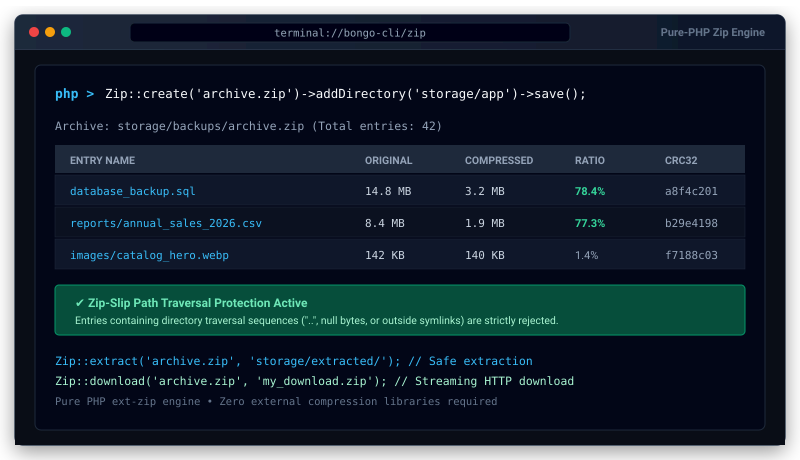

# Zip Archive & Compression for Bongo PHP Framework


<p align="center">
  
</p>
Official zero-dependency Zip archive compression, extraction, and inspection package for Bongo PHP Framework. Create, extract, stream, and inspect `.zip` archives with a fluent API, directory recursion, glob exclusions, and built-in protection against Zip-Slip security vulnerabilities.

---

## 1. Quick Start

### Step 1: Install Package
```bash
php bongo add zip
```

### Step 2: Use via CLI
```bash
# Create archive from folder
php bongo zip:make storage/reports.zip storage/app/reports --exclude=.git,*.tmp

# Extract archive
php bongo zip:extract storage/reports.zip storage/extracted/

# List contents of an archive
php bongo zip:list storage/reports.zip
```

---

## 2. Fluent API Usage

### A. Creating Archives
```php
use Bongo\Packages\Zip\Zip;

// Fluent archive builder
Zip::create('storage/backups/invoices.zip')
    ->add('storage/app/invoices')                  // Add directory recursively
    ->addFile('storage/app/summary.pdf')          // Add single file
    ->addFromString('manifest.json', json_encode(['version' => '1.0'])) // Direct memory string
    ->exclude(['.git', 'node_modules', '*.tmp'])  // Glob exclusions
    ->save();
```

### B. Extracting Archives (Zip-Slip Protected)
```php
use Bongo\Packages\Zip\Zip;

// Quick extraction
Zip::extract('storage/uploads/archive.zip', 'storage/app/extracted');

// Extract specific files only
$reader = Zip::open('archive.zip');
$reader->extractTo('destination/', ['document.pdf', 'contract.pdf']);
$reader->close();
```

### C. Reading Files Directly Without Extracting
```php
use Bongo\Packages\Zip\Zip;

// Read content of a specific file inside archive directly
$content = Zip::read('archive.zip', 'config.json');

// Check if file exists inside archive
if (Zip::has('archive.zip', 'license.txt')) {
    // File exists
}
```

### D. Inspecting Archive Contents
```php
use Bongo\Packages\Zip\Zip;

$entries = Zip::list('archive.zip');

foreach ($entries as $entry) {
    echo "{$entry['name']} - {$entry['size']} bytes ({$entry['date']})\n";
}
```

### E. Streaming Download to Browser
```php
use Bongo\Packages\Zip\Zip;

// Automatically sends proper HTTP headers and streams archive to client
Zip::download('storage/app/export.zip', 'monthly-export.zip');
```

---

## 3. Testing

Run package test suite:
```bash
php run_tests.php zip
```
